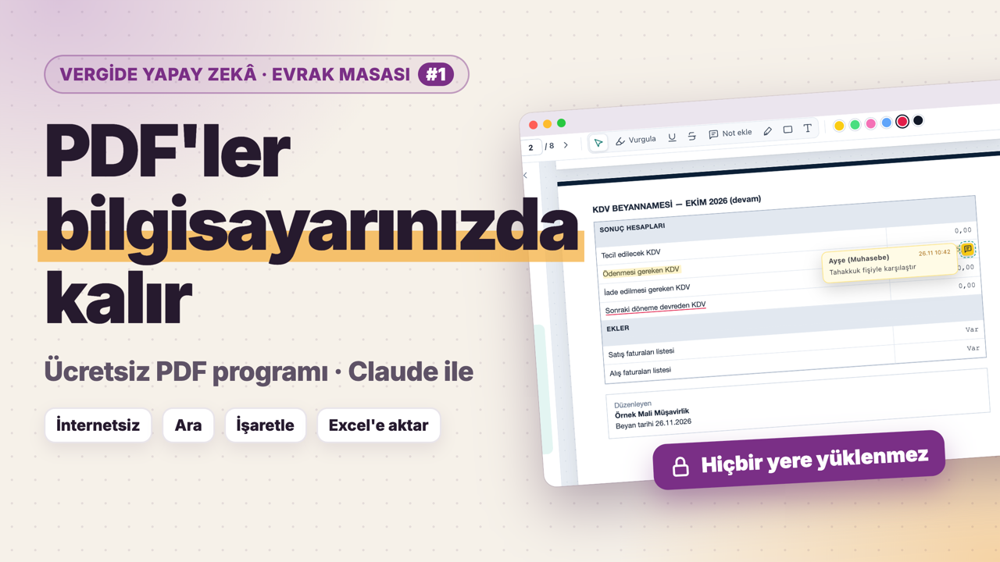

# Evrak Masası

Muhasebe ofisleri için **internete yüklemeden** PDF görüntüleme ve işaretleme aracı.
“Vergide Yapay Zekâ” eğitim serisinin ikinci aracıdır (ilki: Mükellef Kasası).

- **Tek tıkla yüklenir:** Chrome ya da Edge'den kendi simgesi ve penceresiyle bir uygulama gibi yüklenir. İsterseniz tek dosyalık sürümü (`Evrak-Masasi.html`) çift tıklayarak da açabilirsiniz.
- **İnternet gerekmez:** Yüklendikten sonra internetsiz çalışır; gerekli her şey programın içindedir.
- **Dosyalarınız bilgisayarınızdan çıkmaz:** PDF'ler hiçbir sunucuya gönderilmez, tüm işlemler tarayıcının içinde yapılır.

## 🎥 Videoyu izleyin

**Bölüm 1:** Evrak Masası'nın neden tarayıcıda çalıştığını, Claude'a hangi istemlerle yaptırdığımızı, nasıl yüklendiğini ve klasör açma, arama, işaretleme, kaydetme ve Excel'e aktarmayı 4 dakikalık videoda gösteriyoruz.

[](https://www.youtube.com/watch?v=FdwSnbLfboU)

▶️ **https://www.youtube.com/watch?v=FdwSnbLfboU**

## Kurulum: uygulama olarak yükleyin (önerilen)

1. Chrome ya da Edge ile **https://ernozir.github.io/evrak-masasi/** adresini açın.
2. Başlangıç ekranındaki **Uygulama olarak yükle** düğmesine (ya da adres çubuğunun sağındaki yükle simgesine) tıklayın.
3. Evrak Masası kendi simgesiyle Masaüstüne / Başlat menüsüne (Windows) ya da Uygulamalar klasörüne ve Dock'a (macOS) eklenir, kendi penceresinde açılır.

- Yüklendikten sonra **internet olmadan da açılır.**
- Yeni sürüm çıktığında, internet varken bir sonraki açılışta **kendiliğinden güncellenir.**
- Yüklü programla PDF açabilirsiniz: dosyaya sağ tıklayın → **Birlikte aç → Evrak Masası.**
- Program sayfası GitHub'dan bir kez yüklenir; açtığınız PDF'ler yine **hiçbir yere gönderilmez**, bilgisayarınızda işlenir.

İnternete hiç bağlanmak istemeyen bilgisayarlar için tek dosyalık sürüm de var: `dist/Evrak-Masasi.html` dosyasını indirip çift tıklayın.

## Kullanım

1. Bir PDF'i ya da bütün bir klasörü pencereye sürükleyin (veya **Dosya aç / Klasör aç**).
2. Klasör açtıysanız dosyalar alttaki şeritte listelenir; **Alt + ← / →** ile dosyalar arasında geçebilirsiniz.

### Sürüm 0.1'de neler var?

| Özellik | Açıklama |
|---|---|
| Görüntüleme | Sayfa küçük resimleri, yakınlaştırma, sayfaya sığdırma, sayfayı resim olarak kaydetme |
| Klasör / çoklu dosya | Alt şeritte dosya listesi, arama, sıralama, her dosyada kaç işaret olduğu |
| Arama | Belgedeki yazıda arama (tutar, unvan, VKN…), sonuçlar sayfa sayfa |
| İşaretleme | Vurgula, altını çiz, üstünü çiz, not, kalem, kutu, yazı; 6 renk |
| Notlar paneli | Tüm işaretler sayfaya göre listelenir; kim, ne zaman, işaretlenen yazı, açıklama |
| Kaydetme | **Düzenlenebilir** (Acrobat, Edge, Mac Önizleme'de not olarak görünür; Evrak Masası'nda yeniden açınca düzenlenebilir) ya da **Sayfaya göm** (kalıcı) |
| Excel | Klasördeki tüm notları tek Excel dosyasına aktarma |

Yazıyı seçip **H** tuşuna basmak onu hemen vurgular. Tüm kısayollar için programda **F1**.

### Bilinen sınırlar

- Şifreli PDF'ler açılabilir ama üzerine işaret kaydedilemez.
- Taranmış (yalnızca resimden oluşan) sayfalarda yazı seçilemez; vurgu dikdörtgen olarak çizilir.
- Başka programlarla eklenmiş notlar görüntülenir ve listelenir, ama burada değiştirilemez.
- Chrome ve Edge'de denenmiştir. Safari ve Firefox'ta denenmedi.

## Kullanılan istemler

### Bölüm 1'de kullanılan istemler (v0.1)

Programın kodu [Claude](https://claude.ai) ile üretildi. Videoda gösterilen istemler aşağıda; izleyiciye örnek olsun diye biraz sadeleştirildi. Kendi ihtiyacınıza göre değiştirip benzer araçlar üretebilirsiniz.

**İstem 1: fikir**

> Vergide Yapay Zekâ eğitim serimiz için mali müşavirlik, avukatlık ve benzeri ofislerde çok kullanılabilecek bir program yapmak istiyorum. Herkes kolayca açıp kullanabilmeli ve internetsiz çalışmalı; önemli PDF dosyalarını bilmediğimiz web sitelerine yüklemek zorunda kalmayalım. Bu yüzden HTML ve JavaScript ile yapalım. Program bir PDF aracı olsun: PDF görüntüleme, bölme, sayfa silme, birleştirme ve küçültme. Senin de önerilerin varsa ekleyelim. Önce bunun bu şekilde yapılabilir olup olmadığına bakalım.

**İstem 2: tasarım ve görüntüleme**

> Arayüz profesyonel olsun; basit bir PDF aracı gibi değil, bir masaüstü programı gibi görünsün. Fotoğraflardan, fiş ve dekontlardan PDF oluşturma da yapabiliriz.
>
> Görüntüleme ekranında birden fazla dosya ya da bir klasör açıp dosyalar arasında geçebileceğimiz bir şerit olsun. Ofislerde vurgulama, altını çizme ve not alma çok kullanılıyor; bunları da ekleyelim.

Bu istemlerde dikkat ettiğimiz şeyler: **amacı açıkça yazmak** (herkes açabilsin, internetsiz çalışsın, belgeler bilinmeyen sitelere gitmesin), **istediğimiz araçları sayıp Claude'un önerisini de istemek**, kod yazmadan önce **yapılabilir olup olmadığını sormak** ve **ofiste gerçekten ne kullanılıyorsa onu istemek** (vurgulama, altını çizme, not). Bu yüzden PDF dosyalarını ekrana çizen iki kütüphane (pdf.js, pdf-lib) internetten yüklenmiyor, programın içine gömülü. Claude programı uydurma belgelerle (`test/`) denedi.

## Geliştirme

```bash
node derle.js        # src/ + lib/ → dist/Evrak-Masasi.html (tek dosya) ve docs/ (GitHub Pages, yüklenebilir uygulama)
```

- `docs/`: GitHub Pages'te yayınlanan sürüm. `index.html` + `manifest.webmanifest` (ad, simgeler, PDF ile açma) + `sw.js` (çevrimdışı çalışma; yalnızca programın kendi dosyalarını önbelleğe alır). GitHub'da **Settings → Pages → Branch: main, /docs** seçilir.
- `src/pwa/`: uygulama bilgileri, çevrimdışı betik ve simgeler (`araclar/ikon-uret.js` ile `ikon.svg`'den üretilir).

- `src/` kaynak dosyalar (ayrı ayrı okunabilsin diye), `lib/` kütüphaneler, `derle.js` hepsini tek dosyada birleştirir.
- Program çift tıklanarak (`file://`) açıldığı için pdf.js özel bir yolla yüklenir; ayrıntı `src/js/motor.js` başında.
- `test/fikstur.js` uydurma belgeler üretir (Örnek Tekstil, VKN 4820193576). `test/e2e.js` programı uçtan uca dener, `test/pwa.js` yüklenebilirliği ve çevrimdışı açılmayı dener.

## Lisanslar

- [pdf.js](https://github.com/mozilla/pdf.js) 4.10.38 — Apache-2.0 (`lib/LICENSE-pdfjs.txt`)
- [pdf-lib](https://github.com/Hopding/pdf-lib) 1.17.1 — MIT (`lib/LICENSE-pdf-lib.md`)
- `zipwrite.js`, `xlsxwrite.js` Mükellef Kasası'ndan alınmıştır.

## Sorumluluk

Bu araç eğitim amacıyla hazırlanmıştır. Önemli belgelerde işlem yapmadan önce yedek alın; sonuçları kontrol etme sorumluluğu kullanıcıya aittir.
